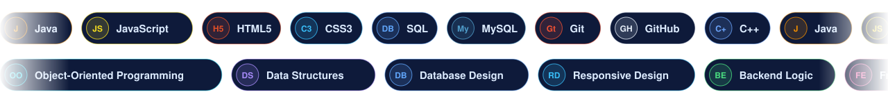
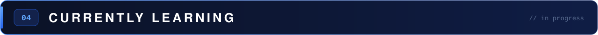

<table align="center">
  <tr>
    <td align="center" width="25%"> </td>
    <td align="center" width="25%"> </td>
    <td align="center" width="25%"> </td>
    <td align="center" width="25%"> </td>
  </tr>
  <tr>
    <td align="center">  Java &middot; JavaScript &middot; C++  </td>
    <td align="center">  HTML &middot; CSS  </td>
    <td align="center">  SQL  </td>
    <td align="center">  Git &middot; GitHub  </td>
  </tr>
</table>

<table align="center">
  <tr>
    <td align="center" width="33%">
       
      
        
      <b>Java</b>
       
      Object-Oriented Programming
        
    </td>
    <td align="center" width="33%">
       
      
        
      <b>Web Development</b>
       
      HTML &middot; CSS &middot; JavaScript
        
    </td>
    <td align="center" width="33%">
       
      
        
      <b>Databases</b>
       
      SQL &amp; Data Modeling
        
    </td>
  </tr>
  <tr>
    <td align="center" width="33%">
       
      
        
      <b>Backend</b>
       
      Application Logic
        
    </td>
    <td align="center" width="33%">
       
      
        
      <b>Frontend</b>
       
      Interfaces &amp; UX
        
    </td>
    <td align="center" width="33%">
       
      
        
      <b>Version Control</b>
       
      Git &amp; GitHub
        
    </td>
  </tr>
</table>

   
  I'm currently looking for opportunities to gain my <b>first professional experience in software development</b>. 
  I'm interested in joining a team where I can:

   
  
  
  

 

