

<a href="https://github.com/Gothi2213"></a>


 






<!-- Fill in PROJECTS in generators/build_all.py, then re-run it. Update the links below to each repo. -->
<table align="center">
  <tr>
    <td width="62%" rowspan="2" valign="top"><a href="https://github.com/Gothi2213?tab=repositories"></a></td>
    <td width="38%" valign="top"><a href="https://github.com/Gothi2213?tab=repositories"></a></td>
  </tr>
  <tr>
    <td valign="top"><a href="https://github.com/Gothi2213?tab=repositories"></a></td>
  </tr>
</table>







  

